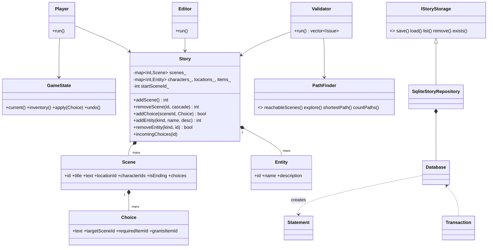
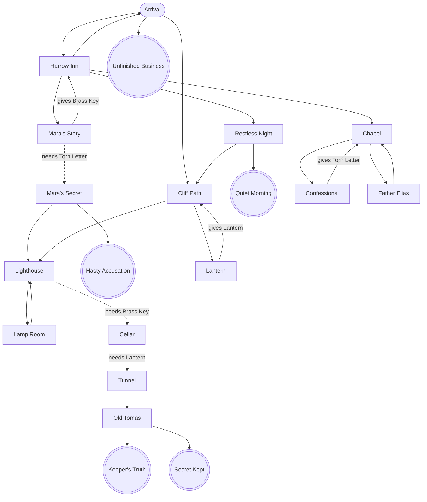

# Architecture

## Class diagram

## Demo story graph ("Harrow Island", clean version)
Dashed = item-gated. Endings in double circles.

## Data flow
`main.cpp (App)` -> `Editor` / `Player` / `Validator` / `PathFinder` operate on one in-memory `Story`;
`IStoryStorage` converts that `Story` to/from SQLite rows inside a transaction.
